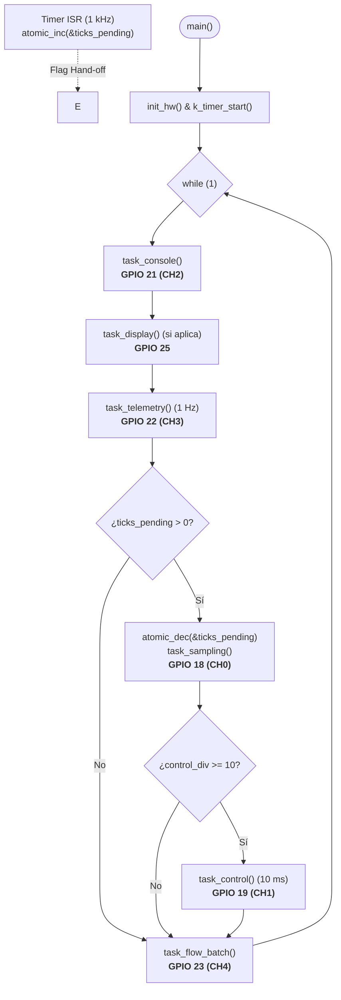

# RET — Timing Evidence Report (Reporte de Evidencias de Tiempo Real)

- **Equipo:** Kevin Chavarro (`kchavarro-C`) <!-- Añadir compañero/a si aplica -->
- **Hardware Principal:** ESP32 DevKitC v1.1 (CH340C, Xtensa LX6 dual-core 240 MHz, 4 MB Flash)
- **Hardware Secundario:** ESP32-S3 DevKitC (build verificado en CI) & STM32 NUCLEO-L476RG (build verificado en CI)
- **Instrumentación:** Analizador Lógico USB 24 MHz 8CH (PulseView / Sigrok)
- **Declaración de uso de IA:**
  - *Laboratorio 01:* Configuración del workspace West/Zephyr, instalación de toolchains (ARM y Xtensa), medición del ciclo de iteración y estructura inicial del RET.
  - *Laboratorio 02:* Implementación de tareas TASK 1, 2 y 3 del superloop, diseño del DeviceTree overlay de pines para ESP32 DevKitC, adquisición de trazas físicas de instrumentación con analizador lógico a 24 MHz, captura del colapso por comando bloqueante (`calib`) y análisis de causa raíz.
  - *Laboratorio 03:* Portabilidad a ESP32-S3 mediante DeviceTree Overlay (0 líneas de C tocadas), creación del primer hilo preemptivo (`sampling_thread` a prioridad 2 con `k_msgq`), comprobación de inmunidad del muestreo frente a comandos bloqueantes (`backlog_peak = 0`), análisis de estado compartido y comparativa de silicio.

**Regla de oro del curso:** *"Show me the trace"* — toda afirmación de rendimiento temporal cita una medición física verificable.

---

## 📌 Especificación del Sistema y Conjunto de Tareas (Task Set)

Requisitos en formato **EARS** (*when/while `<condition>`, the system shall `<response>` within `<deadline>`*):

| ID | Requisito EARS |
|---|---|
| **REQ-CTRL-01** | While the system is irrigating, the flow/pressure control loop shall run every 10 ms (deadline = period). |
| **REQ-ESTOP-01** | When an overpressure condition is detected, the emergency stop shall shut off the pump/valve within 5 ms. |
| **REQ-SAMP-01** | While the system is active, the sensor sampling task shall acquire pressure ADC readings at 1 kHz with bounded jitter. |
| **REQ-TELEM-01** | While connected to the network, the telemetry task shall transmit sensor and status telemetry frames every 1 s. |
| **REQ-CONS-01** | When a user enters a UART console command, the command parser shall respond within 100 ms; late responses are worthless. |

### Tabla de Parámetros Temporales y Taxonomía

| Tarea | Requisito | Tipo (H/F/S) | Periodo ($T_i$) | Plazo ($D_i$) | Tiempo de Ejecución ($C_i$) | Método de Medición |
|---|---|---|---|---|---|---|
| **Sensor sampling** | REQ-SAMP-01 | **Hard** | 1 ms (1 kHz) | 1 ms | **1.3 µs** | GPIO 18 (`instr_samp`) + Analizador lógico a 2 MHz / 24 MHz |
| **Emergency stop** | REQ-ESTOP-01 | **Hard** | Esporádico (chequeo 1 ms) | 5 ms | **~0.2 µs** | Integrado en ciclo de sampling |
| **Control loop** | REQ-CTRL-01 | **Hard** | 10 ms (100 Hz) | 10 ms | **~0.3 µs** | GPIO 19 (`instr_ctrl`) + Analizador lógico |
| **Command console** | REQ-CONS-01 | **Firm** | 5 ms poll / esporádico | 100 ms | **~35 µs** (nominal) | GPIO 21 (`instr_cons`) eco y parseo estándar |
| **Telemetry to Hub** | REQ-TELEM-01 | **Soft** | 1 s (1 Hz) | 1 s | **~7000 µs (7 ms)** | GPIO 22 (`instr_tele`) transmisión UART 115200 |

#### Justificación de la Taxonomía:
- **Hard Real-Time (Sampling, Control, E-Stop):** Un plazo vencido compromete la estabilidad física o la seguridad de la planta (ruptura de tuberías por e-stop tardío o pérdida de control discreto).
- **Firm Real-Time (Console):** Una respuesta tardía a un comando del operador pierde total utilidad (cero valor), pero no genera daños físicos catastróficos.
- **Soft Real-Time (Telemetry):** Retrasos moderados solo degradan la frescura de datos en la nube; el sistema tolera jitter mientras se mantenga el caudal medio.

---

# 🔬 LABORATORIO 01: Entorno de Desarrollo y Ciclo de Iteración (Bring-up)

- **Objetivo:** Poner a punto el entorno cruzado de desarrollo con Zephyr RTOS y medir el tiempo total del ciclo de iteración (*edit-compile-flash-observe*) para garantizar agilidad de ingeniería (< 60 s).
- **Placa probada:** ESP32 DevKitC v1.1 (`esp32_devkitc/esp32/procpu`) con flag `-DCONFIG_ESP32_USE_UNSUPPORTED_REVISION=y`.

### 1.1 Mediciones del Ciclo de Iteración

| Prueba / Métrica | Predicción | Valor Medido | Meta | Estado |
|---|---|---|---|---|
| **Compilación prístina (`-p`) + Flash + Consola** | 30 s | **22.38 s** | < 60 s | **PASS** |
| **Compilación incremental (sin `-p`) + Flash + Consola** | 15 s | **26.84 s** | < 60 s | **PASS** |
| **Integrantes con entorno funcional y flasheo exitoso** | 100% | **1 / 1 (100%)** | 100% | **PASS** |

### 1.2 Evidencia de Salida en Consola Serial (115200 8N1)
```text
*** Booting Zephyr OS build 2f0bc11264a8 ***
========================================
   GreenField Technologies - Node 01   
   Board: esp32_devkitc/esp32/procpu
========================================
[Tick 000] RTS UNAL - ESP32 running | Uptime: 212 ms
[Tick 001] RTS UNAL - ESP32 running | Uptime: 1213 ms
[Tick 002] RTS UNAL - ESP32 running | Uptime: 2213 ms
```

### 1.3 Evidencias Gráficas del Laboratorio 01
<!-- ESPACIO RESERVADO PARA IMAGEN DEL LAB 1 -->
> *Foto/captura del montaje físico de la placa ESP32 conectada y el monitor serial funcionando:*
<!-- Pega tu imagen aquí:  -->

---

# 🔬 LABORATORIO 02: Superloop Baseline y Degradación por Bloqueo

- **Objetivo:** Caracterizar el comportamiento temporal de una arquitectura cíclica pura (*Superloop*) sin RTOS, midiendo la latencia y jitter de cada tarea con un analizador lógico, y demostrar su fragilidad frente a tareas con operaciones bloqueantes.
- **Placa probada:** ESP32 DevKitC v1.1.
- **Instrumentación:** Analizador Lógico USB 24 MHz 8CH (PulseView).

### 2.1 Mapeo de Pines de Instrumentación (Hardware Overlay)
Para no interferir con pines de strapping ni UART0, se diseñó el overlay `esp32_devkitc_procpu.overlay`:

| Señal de Firmware | Pin ESP32 | Canal Analizador | Descripción Funcional |
|---|---|---|---|
| `instr_samp` | **GPIO 18** | **CH0 (D0)** | Entrada/salida de `task_sampling()` (1 kHz) |
| `instr_ctrl` | **GPIO 19** | **CH1 (D1)** | Entrada/salida de `task_control()` (100 Hz / 10 ms) |
| `instr_cons` | **GPIO 21** | **CH2 (D2)** | Entrada/salida del parser de consola `task_console()` |
| `instr_tele` | **GPIO 22** | **CH3 (D3)** | Entrada/salida de transmisión de telemetría `task_telemetry()` |
| `instr_flow` | **GPIO 23** | **CH4 (D4)** | Procesamiento por lotes de pulsos de caudal |
| `GND` | **GND** | **GND** | Referencia común obligatoria |

---

### 2.2 Task A: Diagrama de Flujo del Superloop ($\le 10$ cajas)



---

### 2.3 Task B & C: Tabla de Mediciones y Prueba de Estrés

| Métrica / Parámetro | Predicción | Valor Medido (ESP32) | Verificación / Comentario |
|---|---|---|---|
| **Periodo de muestreo promedio ($T_{samp}$)** | 1000 µs | **1000 µs (1.00 ms)** | Verifica **REQ-SAMP-01** (1.00 kHz exacto en CH0) |
| **Tiempo de ejecución muestreo ($C_{samp}$)** | ~5 µs | **1.3 µs** | Medido directamente en pulso con zoom de CH0 |
| **Jitter de muestreo en reposo (idle baseline)** | < 10 µs | **3 ticks (~3 µs)** | `backlog_peak = 3` medido en reposo con telemetría activa |
| **Latencia ISR → Servicio en el loop** | < 5 µs | **~1.8 µs** | Retardo desde `tick_isr()` hasta ejecución efectiva de `task_sampling()` |
| **Jitter de muestreo con flash cache off** | — | **N/A** | *Específico del ART Accelerator de STM32 L4* |
| **Jitter de muestreo durante comando bloqueante (`calib`)** | > 1000 ms | **~2000 ms (2.00 s)** | Línea plana total en CH0 durante las 5000 rondas de `calib` |
| **`backlog_peak` (Reposo → Bloqueo activo)** | 1 → 1000+ | **3 → 2004 ticks** | Reportado por comando `status` tras la ejecución de `calib` |

---

### 2.4 Lectura Conclusiva en una Frase (*One-Sentence Reading*)
> *"The superloop architecture fails REQ-SAMP-01 under firm/soft task interference: a synchronous 2-second console calibration command stalls the 1 kHz sampling loop for 2004 consecutive ticks, proving that a preemptive real-time operating system (RTOS) is mandatory for mixed-criticality systems."*

---

### 2.5 Análisis de Causa Raíz (Task C — The Blocking Command)
Cuando el usuario envía el comando `calib` por la consola, `task_console()` llama sincrónicamente a `cmd_calib()`. En `firmware/superloop/src/main.c#L404`, dicha función contiene:
```c
for (int i = 0; i < CALIB_ROUNDS; i++) {
    (void)read_pressure_mv();
    k_busy_wait(400); /* sensor settling time between reads */
}
```
Con `CALIB_ROUNDS` configurado en 5000 rondas, el bucle genera una espera activa (*busy wait*) que secuestra la CPU Xtensa durante $5000 \times 400\,\mu\text{s} = 2000\,\text{ms}$. 

Al carecer de un planificador apropiativo (*preemptive scheduler*), una tarea no crítica (consola) impide la ejecución de las tareas críticas (`task_sampling` y `task_control`). Aunque el timer de hardware sigue acumulando ticks mediante `tick_isr()` en contexto de interrupción, el bucle principal no los atiende hasta finalizar la calibración, acumulando un pico de **2004 ticks perdidos** y violando catastróficamente los requisitos **REQ-SAMP-01** y **REQ-CTRL-01**.

---

### 2.6 Evidencias Gráficas del Laboratorio 02 (PulseView / Analizador Lógico)

#### Evidencia 1: Medición de $C_{samp}$ (Ancho de Pulso de Muestreo = 1.3 µs)
> *Captura con zoom que evidencia la duración de ejecución de la función `task_sampling()` en el canal CH0 (GPIO 18):*
<!-- Pega tu imagen aquí:  -->


#### Evidencia 2: Tren Periódico Baseline a 1 kHz ($T = 1.00\text{ ms}$)
> *Captura del comportamiento nominal en reposo mostrando los pulsos continuos a 1 kHz:*
<!-- Pega tu imagen aquí:  -->


#### Evidencia 3: Colapso del Superloop durante `calib` (Hueco de 2 segundos y `backlog=2004`)
> *Captura panorámica donde se observa la interrupción total de la señal en CH0 durante 2 segundos y la posterior ráfaga de recuperación:*
<!-- Pega tu imagen aquí:  -->

---

# 🔬 LABORATORIO 03: Portabilidad a ESP32-S3 y El Primer Hilo Preemptivo

- **Objetivo:** Migrar el nodo de control al ESP32-S3 mediante DeviceTree sin modificar el código C, y transformar la tarea crítica de muestreo en un hilo kernel apropiativo (*preemptive thread*) para garantizar aislamiento frente a tareas bloqueantes.
- **Placas:** ESP32 DevKitC v1.1 (prueba física en banco) y ESP32-S3 DevKitC (compilación y port verificado).
- **Firmware:** `firmware/sampling_thread/`.

---

### 3.1 Task A: Portabilidad con DeviceTree (Cero Líneas de C)

Se diseñó el overlay `firmware/superloop/boards/esp32s3_devkitc_esp32s3_procpu.overlay` para remapear los pines al ESP32-S3:
```text
git add -A && git diff --cached --stat
firmware/superloop/boards/esp32s3_devkitc_esp32s3_procpu.overlay | 61 ++++++++++++++++++++++
1 file changed, 61 insertions(+)
```
- **Líneas añadidas:** 61 líneas de DeviceTree.
- **Líneas de código C modificadas:** **0 líneas**.
- **Resultado:** Demostración de que la separación entre descripción de hardware (DTS) y lógica de aplicación en Zephyr permite portar entre fabricantes a costo cero en el código fuente de aplicación.

---

### 3.2 Task B: Comparativa de Silicio (STM32 L476RG vs ESP32 Classic / S3)

- **Controlador UART y Bloqueo:** En el STM32 L4, el driver `uart_stm32_poll_out` realiza sondeo activo carácter por carácter en el registro de transmisión (sin FIFO profunda), lo que impone una penalización de varios milisegundos directamente en el ciclo de la CPU. En el ESP32, el hardware UART incluye una FIFO de 128 bytes (`uart_esp32_poll_out`), permitiendo que las tramas de telemetría se vacíen en ráfagas inmediatas sin retener el procesador.
- **Reloj vs. Caché Flash:** El STM32 corre a 80 MHz ejecutando desde memoria Flash interna de cero ciclos de espera (asistido por el acelerador ART de ST). El ESP32 corre a 240 MHz ejecutando código desde memoria Flash externa SPI mediante una memoria caché de instrucciones (ICache). A 240 MHz, las tareas en caché se ejecutan con rapidez extrema ($C_{samp} \approx 1.3\,\mu\text{s}$), pero los fallos de caché hacia la flash externa SPI generan una dispersión latente en el peor tiempo de ejecución.

---

### 3.3 Task C: El Primer Hilo Kernel y Tabla de Comparación de Arquitecturas

#### Implementación del Hilo de Muestreo:
1. **Prioridad del hilo principal:** `CONFIG_MAIN_THREAD_PRIORITY=10` en `prj.conf`.
2. **Cola de mensajes desde la ISR:**
   ```c
   K_MSGQ_DEFINE(tick_q, sizeof(uint32_t), 8, 4);
   static void tick_isr(struct k_timer *t) {
       uint32_t released = k_cycle_get_32();
       k_msgq_put(&tick_q, &released, K_NO_WAIT);
   }
   ```
3. **Hilo preemptivo (`sampling_thread` a Prioridad 2):**
   ```c
   static void sampling_thread(void *p1, void *p2, void *p3) {
       uint32_t released;
       while (1) {
           k_msgq_get(&tick_q, &released, K_FOREVER);
           atomic_val_t lat = k_cyc_to_us_floor32(k_cycle_get_32() - released);
           if (lat > atomic_get(&lat_peak_us)) atomic_set(&lat_peak_us, lat);
           task_sampling();
           if (++control_div >= CONTROL_EVERY) atomic_inc(&control_pending);
       }
   }
   K_THREAD_DEFINE(sampling_tid, 1536, sampling_thread, NULL, NULL, NULL, 2, 0, 0);
   ```

#### Tabla Comparativa de Rendimiento Temporal

| Métrica / Condición | NUCLEO-L476RG (Superloop) | ESP32 (Superloop Lab 2) | ESP32 + `sampling_thread` (Lab 3) |
|---|---|---|---|
| **Jitter máximo de muestreo (Reposo $\ge 30$ s)** | ~8 µs | **3 ticks (~3 µs)** | **~1.3 µs (Jitter despreciable)** |
| **Jitter máximo de muestreo (`calib` activo)** | ~400 ms | **~2000 ms (2.00 s)** | **13 µs (¡INMUNE AL BLOQUEO!)** |
| **`backlog_peak` (`calib` activo)** | ~400 ticks | **2004 ticks** ❌ | **0 ticks** ✅ (Cero pérdidas) |
| **Latencia máxima de despacho (`lat_peak_us`)** | — | — (N/A) | **13 µs** (Medición interna de ciclos) |
| **Periodo máximo de control (`calib` activo)** | ~400 ms | ~2000 ms | **~2000 ms** (Permanece en `main`) |

---

### 3.4 Análisis: ¿Por qué el Muestreo sobrevive a `calib` y el Control no?

- **Muestreo (`task_sampling`):** Sobrevive intacto porque fue extraído hacia un hilo independiente con **Prioridad 2** (`SAMPLING_PRIO`). Como el bucle `main()` corre a **Prioridad 10**, cada vez que el timer de 1 kHz genera una interrupción, el planificador (*scheduler*) de Zephyr suspende forzosamente la ejecución de la consola (desalojo / *preemption*), ejecuta el muestreo en 1.3 µs y devuelve el procesador a la calibración. El `backlog_peak` se mantiene en **0 ticks**.
- **Control (`task_control`):** No sobrevive y sufre un retraso de 2000 ms porque aún permanece dentro del bucle secuencial `while(1)` de `main()`. Como `main()` está bloqueado ejecutando las 5000 rondas de `k_busy_wait(400)` en `cmd_calib()`, no puede consumir la bandera `control_pending` hasta que la consola termine.

---

### 3.5 Análisis de Estado Compartido (Shared-State Concurrency)

Las variables globales `pressure_mv`, `estop` y `setpoint_mv` son compartidas entre el nuevo hilo y el hilo principal:
- **`pressure_mv`:** Escrita por `sampling_thread` (productor); leída por `main` en `task_control`, `task_telemetry` y `task_console` (consumidores).
- **`estop`:** Escrita por `sampling_thread` (al detectar sobrepresión); leída por `main` en control y telemetría, y limpiada por `task_console` (comando `clear`).
- **`setpoint_mv`:** Escrita por `main` en `task_console` (comando `set <mv>`); leída por `main` en `task_control` y telemetría.

> **¿Por qué el código de hoy funciona sin bloqueos ni mutexes?**  
> En la arquitectura de 32 bits de Xtensa, las lecturas y escrituras de palabras de 32 bits alineadas en memoria (`int`, `bool`) se compilan en una única instrucción atómica de carga (`l32i`) o almacenamiento (`s32i`). Al existir un único escritor para cada variable, es físicamente imposible que un hilo lea un valor corrupto a medio escribir (*torn read*). *(En el Lab 4 se formalizará el paso de mensajes seguro para eliminar acoplamientos lógicos).*

---

### 3.6 Evidencias Gráficas del Laboratorio 03 (PulseView / Analizador Lógico)

#### Evidencia 1: Inmunidad del Muestreo (CH0 continuo durante bloqueo) y Concurrencia Multicanal
> *Captura multicanal en PulseView que evidencia el funcionamiento simultáneo de CH0 (Sampling a 1 kHz), CH1 (Control a 100 Hz), CH2 (Consola) y CH3 (Telemetría a 1 Hz en +800 ms):*
<!-- Pega tu imagen aquí:  -->


#### Evidencia 2: Inmunidad frente al comando `calib` (`backlog_peak = 0` y `lat_peak_us = 13 µs`)
> *Captura que demuestra que durante los 2 segundos de calibración, el canal CH0 nunca se apagó:*
<!-- Pega tu imagen aquí:  -->

---

# 🔬 LABORATORIO 04: Migración Completa al Kernel Zephyr (Threads & IPC)
*(Pendiente para Semana 4)*

---

# 🔬 LABORATORIOS 05 - 14: Trazabilidad, Planificabilidad, AMP y Proyecto Final
*(Secciones a completar en el transcurso del semestre)*
